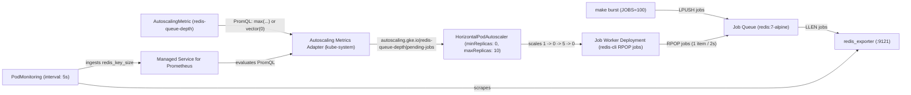
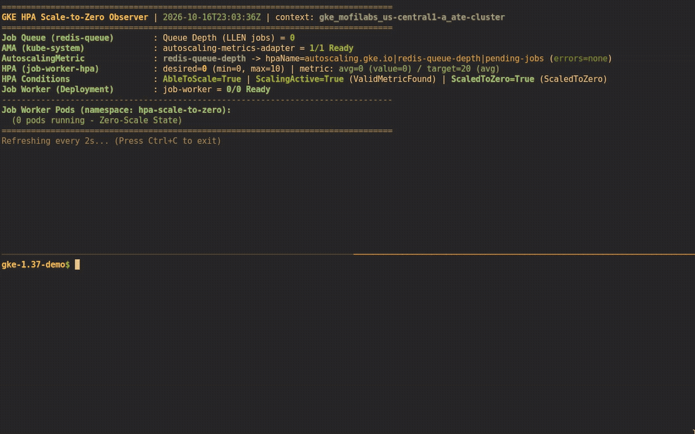

# Scaling Kubernetes deployments to zero on GKE 1.37 without KEDA

Queue workers spend a lot of time doing nothing. If you run batch document parsers, webhook consumers, or background job processors, keeping `minReplicas: 1` alive across dozens of services burns cluster capacity all night just waiting for a message to arrive.

Until now, scaling a Deployment down to zero pods on Google Kubernetes Engine meant picking between two compromises.

You could install KEDA. I like KEDA, and for complex event sources it is still great, but it means running another operator and another metrics API server in `kube-system`, plus teaching every team `ScaledObject` CRDs instead of standard `HorizontalPodAutoscaler` manifests.

Or you could wire up `custom-metrics-stackdriver-adapter` with Workload Identity and scale against a Cloud Monitoring metric like Cloud Pub/Sub `num_undelivered_messages`. That works on paper, but Pub/Sub metrics sample every 60 seconds and have up to a 150-second ingestion lag. Waiting two minutes for your first worker pod to wake up feels broken when a user is waiting on a job.

GKE 1.37 changes this math. Two native features now work together out of the box:

- Kubernetes `HPAScaleToZero` is enabled on the GKE control plane, so a standard `autoscaling/v2` HPA can set `minReplicas: 0` whenever it scales on `External` or `Object` metrics.
- GKE's `AutoscalingMetric` custom resource and managed `autoscaling-metrics-adapter` evaluate arbitrary PromQL queries against Google Cloud Managed Service for Prometheus and feed the result straight into the Kubernetes External Metrics API.

I built a small, zero-build repo at [github.com/moficodes/gke-hpa-scale-to-zero](https://github.com/moficodes/gke-hpa-scale-to-zero) to test how fast native GKE scale-to-zero reacts on a live `v1.37.0-gke.3503000` cluster. The workload wakes from `0` to `5` running pods in 11 seconds when 100 jobs hit the queue, drains the backlog, and scales cleanly back to `0`.

## How the native GKE 1.37 path compares

| Feature | Legacy Stackdriver adapter | KEDA `ScaledObject` | GKE 1.37 `AutoscalingMetric` + `minReplicas: 0` |
| :--- | :--- | :--- | :--- |
| Metrics server in `kube-system` | Self-managed Deployment | Self-managed KEDA operator + adapter | GKE-managed `autoscaling-metrics-adapter` |
| HPA resource | Standard `autoscaling/v2` HPA | Generated and owned by KEDA | Standard `autoscaling/v2` HPA with `minReplicas: 0` |
| Query language | Cloud Monitoring filter strings | Scaler-specific YAML triggers | PromQL via `AutoscalingMetric` |
| Idle footprint when unused | Adapter pod always running | Operator and adapter pods always running | Adapter stays at `0/0` until an `AutoscalingMetric` with `promql` exists |
| Wake-from-zero reaction time | 60s to 90s+ on Pub/Sub metrics | 5s to 15s | 5s to 11s with a 5s `PodMonitoring` scrape |

One detail I appreciated right away is how GKE manages `kube-system/autoscaling-metrics-adapter`. On a fresh GKE 1.37 cluster, that Deployment sits at `0/0` replicas. You pay nothing for it. The moment you apply an `AutoscalingMetric` resource containing a `promql` block, GKE scales the adapter to `1/1` Ready automatically.

## What we are building

I wanted a demo anyone could run in two minutes without building container images, creating Cloud Pub/Sub topics, or configuring IAM service accounts. Everything runs inside the `hpa-scale-to-zero` namespace using two upstream images, `redis:7-alpine` and `oliver006/redis_exporter:v1.62.0`.



**Redis queue and exporter.** A single Redis pod stores pending work items in a list named `jobs`. A `redis_exporter` sidecar runs in the same pod with `--check-keys=jobs` and exposes the list length `LLEN jobs` on port `9121` as the Prometheus gauge `redis_key_size{key="jobs"}`.

**5-second `PodMonitoring`.** Google Cloud Managed Service for Prometheus scrapes the exporter port every `5s`.

**`AutoscalingMetric`.** A `redis-queue-depth` custom resource runs a PromQL query against Managed Service for Prometheus and exposes the result to HPA as an external metric named `autoscaling.gke.io|redis-queue-depth|pending-jobs`.

**HPA and worker Deployment.** `job-worker-hpa` targets an `AverageValue` of `20` pending jobs per pod, with `minReplicas: 0` and `maxReplicas: 10`. Each `job-worker` pod runs a tiny shell loop that pops one item from Redis every 2 seconds with `redis-cli -h redis-queue rpop jobs` and logs it to stdout.

## Follow along on your own cluster

If you have a GKE 1.37+ cluster with Managed Service for Prometheus enabled, you can run the whole loop in three commands.

Clone the repository first:

```bash
git clone https://github.com/moficodes/gke-hpa-scale-to-zero.git
cd gke-hpa-scale-to-zero
```

### Step 1: Apply the manifests

First, look at `manifests/01-redis-queue.yaml`, which sets up the Redis instance, the exporter sidecar, and the 5-second `PodMonitoring` scrape:

```yaml
apiVersion: apps/v1
kind: Deployment
metadata:
  name: redis-queue
  namespace: hpa-scale-to-zero
spec:
  replicas: 1
  selector:
    matchLabels:
      app: redis-queue
  template:
    metadata:
      labels:
        app: redis-queue
    spec:
      containers:
        - name: redis
          image: redis:7-alpine
          ports:
            - name: redis
              containerPort: 6379
        - name: exporter
          image: oliver006/redis_exporter:v1.62.0
          args:
            - "--redis.addr=redis://localhost:6379"
            - "--check-keys=jobs"
          ports:
            - name: metrics
              containerPort: 9121
---
apiVersion: monitoring.googleapis.com/v1
kind: PodMonitoring
metadata:
  name: redis-queue-monitoring
  namespace: hpa-scale-to-zero
spec:
  selector:
    matchLabels:
      app: redis-queue
  endpoints:
    - port: metrics
      interval: 5s
```

Next is `manifests/02-worker-and-hpa.yaml`, which defines the `AutoscalingMetric`, the worker Deployment, and the HPA with `minReplicas: 0`:

```yaml
apiVersion: autoscaling.gke.io/v1beta1
kind: AutoscalingMetric
metadata:
  name: redis-queue-depth
  namespace: hpa-scale-to-zero
spec:
  metrics:
    - promql:
        name: pending-jobs
        type: External
        query: 'max(redis_key_size{namespace="hpa-scale-to-zero", key="jobs"}) or vector(0)'
---
apiVersion: apps/v1
kind: Deployment
metadata:
  name: job-worker
  namespace: hpa-scale-to-zero
spec:
  replicas: 1
  selector:
    matchLabels:
      app: job-worker
  template:
    metadata:
      labels:
        app: job-worker
    spec:
      terminationGracePeriodSeconds: 5
      containers:
        - name: worker
          image: redis:7-alpine
          command: ["/bin/sh", "-c"]
          args:
            - |
              echo "[$(date -u +'%Y-%m-%dT%H:%M:%SZ')] [$(hostname)] Job Worker started; polling redis-queue..."
              while true; do
                JOB="$(redis-cli -h redis-queue rpop jobs 2>/dev/null || true)"
                if [ -n "${JOB}" ]; then
                  echo "[$(date -u +'%Y-%m-%dT%H:%M:%SZ')] [$(hostname)] Processed job: ${JOB}"
                fi
                sleep 2
              done
---
apiVersion: autoscaling/v2
kind: HorizontalPodAutoscaler
metadata:
  name: job-worker-hpa
  namespace: hpa-scale-to-zero
spec:
  scaleTargetRef:
    apiVersion: apps/v1
    kind: Deployment
    name: job-worker
  minReplicas: 0
  maxReplicas: 10
  behavior:
    scaleUp:
      stabilizationWindowSeconds: 0
      policies:
        - type: Pods
          value: 10
          periodSeconds: 15
    scaleDown:
      stabilizationWindowSeconds: 15
  metrics:
    - type: External
      external:
        metric:
          name: autoscaling.gke.io|redis-queue-depth|pending-jobs
        target:
          type: AverageValue
          averageValue: "20"
```

Deploy both files with `make apply`:

```bash
make apply
```

### Step 2: Open the live observer

In one terminal pane, run `make watch` to refresh the queue depth, adapter status, HPA conditions, and worker pods every 2 seconds, or run `make status` for a single snapshot:

```bash
make watch
```

Within about 45 seconds of `make apply`, the initial worker pod scales down to `0/0` Ready and HPA reports `ScaledToZero=True`.

### Step 3: Push a 100-job burst

In a second terminal, push 100 synthetic jobs into Redis in one `LPUSH` call:

```bash
make burst JOBS=100
```

Watch the first terminal as HPA wakes `job-worker` from `0` to `5` pods, drains all 100 items, waits 15 seconds for the scale-down stabilization window, and scales back to `0`. When you are done, delete the namespace with `make clean`:

```bash
make clean
```

## Live demo on GKE 1.37

If you do not want to spin up a cluster right now, the recording below shows a full run on a live GKE `v1.37.0-gke.3503000` cluster where the stack is already deployed and sitting at `0/0` replicas. It walks through the Kubernetes objects in `hpa-scale-to-zero`, triggers `make burst JOBS=100`, shows the `0 -> 5` wake-up and live worker logs as the pods drain the queue, and captures HPA scaling the Deployment back down to `0/0` Ready.



*Watch the high-resolution MP4 recording: [assets/demo.mp4](https://github.com/moficodes/gke-hpa-scale-to-zero/raw/main/assets/demo.mp4)*

| Event | Timestamp (UTC) | Elapsed from burst | HPA `desired` | `ScaledToZero` | `job-worker` Ready |
| :--- | :--- | :--- | :--- | :--- | :--- |
| Initial scale-to-zero complete | `21:32:59Z` | `-14s` | `0` | `True` | `0/0` |
| `make burst JOBS=100` (`LLEN jobs = 100`) | `21:33:13Z` | `0s` | `0` | `True` | `0/0` |
| HPA updates target scale (`0 -> 5`) | `21:33:18Z` | `+5s` | `5` | `False` | `0/0` |
| All 5 `job-worker` pods `Running` & `Ready` | `21:33:24Z` | `+11s` | `5` | `False` | `5/5` |
| Queue drained (`LLEN jobs = 0`) | `21:34:08Z` | `+55s` | `1` | `False` | `1/1` |
| HPA scales to zero after 15s window | `21:34:28Z` | `+75s` | `0` | `True` | `0/1` |
| Final pod terminated (`0/0` Ready) | `21:34:35Z` | `+82s` | `0` | `True` | `0/0` |

## A few things to keep in mind

When you adapt these manifests for your own workloads, watch out for three sharp edges that we documented in the repo's [troubleshooting guide](https://github.com/moficodes/gke-hpa-scale-to-zero/blob/main/TROUBLESHOOTING.md):

**Use `or vector(0)` when your idle metric disappears.** Redis deletes a list key as soon as the last item is popped, which makes `redis_exporter` stop emitting `redis_key_size{key="jobs"}`. An empty PromQL vector shows up as `<unknown>` in HPA and blocks scale-down to zero. Appending `or vector(0)` guarantees a `0` series whenever the queue is empty. See [Troubleshooting #1](https://github.com/moficodes/gke-hpa-scale-to-zero/blob/main/TROUBLESHOOTING.md#1-empty-redis-lists-and-or-vector0-in-autoscalingmetric) and [ADR-0001](https://github.com/moficodes/gke-hpa-scale-to-zero/blob/main/docs/adr/0001-redis-podmonitoring-over-pubsub-for-fast-scale-to-zero.md).

**Start the Deployment at `replicas: 1`, not `replicas: 0`.** If you apply a Deployment with `replicas: 0` before the metrics adapter is ready, or manually run `kubectl scale --replicas=0`, GKE's HPA controller assumes a human operator intentionally turned the service off and pauses autoscaling with `ScalingDisabledReplicaCountZero`. Starting at `replicas: 1` lets HPA itself actuate the initial `1 -> 0` scale-down (`ScaledToZero: True`). See [Troubleshooting #2](https://github.com/moficodes/gke-hpa-scale-to-zero/blob/main/TROUBLESHOOTING.md#2-starting-at-replicas-1-instead-of-replicas-0-scalingdisabledreplicacountzero) and [ADR-0002](https://github.com/moficodes/gke-hpa-scale-to-zero/blob/main/docs/adr/0002-initial-single-replica-for-hpa-actuated-scale-to-zero.md).

**Set an explicit `Pods` policy in `scaleUp.policies`.** Kubernetes HPA's default scale-up policy allows the larger of `100%` of current pods or `4` pods per 15 seconds. When waking from `0` replicas, `100%` of `0` is `0`, so the default `Pods: 4` rule caps your initial wake-from-zero step at 4 pods unless you raise the `Pods` policy limit. See [Troubleshooting #3](https://github.com/moficodes/gke-hpa-scale-to-zero/blob/main/TROUBLESHOOTING.md#3-default-scaleup-policies-cap-wake-from-zero-at-4-pods) and [ADR-0003](https://github.com/moficodes/gke-hpa-scale-to-zero/blob/main/docs/adr/0003-explicit-pods-scaleup-policy-for-wake-from-zero.md).

All the manifests, the observer script, and the troubleshooting notes live in [github.com/moficodes/gke-hpa-scale-to-zero](https://github.com/moficodes/gke-hpa-scale-to-zero).
