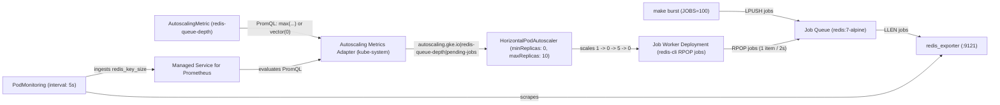

# Native HPA scale-to-zero on GKE 1.37 with AutoscalingMetric and Managed Prometheus

Asynchronous worker pools spend a lot of their life waiting for work. Whether you run batch document parsers, webhook consumers, or queue-driven inference workers, keeping `minReplicas: 1` running 24/7 across dozens of microservices wastes cluster capacity when queues are empty.

Until recently, scaling a Kubernetes Deployment down to `0` replicas and waking it back up from queue metrics on Google Kubernetes Engine (GKE) meant picking between two operational trade-offs:

1. Installing and maintaining a third-party operator such as KEDA, which brings its own custom resources (`ScaledObject`) and its own metrics server into `kube-system`.
2. Installing the legacy `custom-metrics-stackdriver-adapter` with Workload Identity bindings and scaling against Cloud Monitoring metrics like Cloud Pub/Sub's `num_undelivered_messages`, which samples every 60 seconds and often takes 60 to 90 seconds before the Horizontal Pod Autoscaler (HPA) even sees a new burst of work.

With GKE 1.37 (`v1.37.0-gke.3503000`), two built-in capabilities come together so you can run fast scale-to-zero using standard Kubernetes `HorizontalPodAutoscaler` (`autoscaling/v2`) objects and zero third-party operators:

- Upstream Kubernetes `HPAScaleToZero` is enabled on the GKE control plane, allowing `minReplicas: 0` on HPAs that scale on `External` or `Object` metrics.
- GKE's native `AutoscalingMetric` custom resource (`autoscaling.gke.io/v1beta1`) and managed Autoscaling Metrics Adapter (AMA) (`kube-system/autoscaling-metrics-adapter`) evaluate arbitrary PromQL queries against Google Cloud Managed Service for Prometheus (`PodMonitoring`) and expose the results directly through the Kubernetes External Metrics API.

This guide walks through a complete, zero-build reference stack (`moficodes/gke-hpa-scale-to-zero`) verified on a live GKE `v1.37.0-gke.3503000` cluster (`ate-cluster`). We will look at how the pieces fit together, three subtle production lessons we uncovered while testing on a real cluster, and the exact terminal outputs and second-by-second timings across a `1 -> 0 -> 5 -> 0` scaling cycle.

## How GKE native HPA scale-to-zero compares

| Capability | Legacy `custom-metrics-stackdriver-adapter` | KEDA (`ScaledObject`) | GKE 1.37 `AutoscalingMetric` + `minReplicas: 0` |
| :--- | :--- | :--- | :--- |
| Control plane component | Self-managed Deployment in `kube-system` | Self-managed KEDA operator + metrics apiserver | GKE-managed `autoscaling-metrics-adapter` (AMA) |
| HPA definition | Standard `autoscaling/v2` HPA | Generated and owned by KEDA `ScaledObject` | Standard `autoscaling/v2` HPA (`minReplicas: 0`) |
| Query language | Cloud Monitoring filters | Scaler-specific YAML triggers | Full PromQL via `AutoscalingMetric` (`autoscaling.gke.io/v1beta1`) |
| Idle footprint when unused | Adapter pod always running | Operator + adapter pods always running | AMA stays at `0/0` until an `AutoscalingMetric` with `promql` exists |
| Wake-from-zero reaction time | 60s to 90s+ (Cloud Pub/Sub sampling) | 5s to 15s (direct broker polling) | ~5s to 11s (`5s` `PodMonitoring` scrape + PromQL) |

## Architecture of the zero-build demo stack

To make the scaling loop easy to reproduce in under two minutes without building container images or configuring GCP IAM, the demo runs entirely inside the `hpa-scale-to-zero` namespace using two upstream images (`redis:7-alpine` and `oliver006/redis_exporter:v1.62.0`).



Here is how data flows from the Redis list to the HPA controller:

1. **Job Queue (`Deployment/redis-queue`)**: A single-replica Redis instance holds pending items in a Redis list named `jobs`. An `oliver006/redis_exporter:v1.62.0` sidecar runs alongside it with `--check-keys=jobs`, exposing the instantaneous Queue Depth (`LLEN jobs`) on port `9121` as the Prometheus gauge `redis_key_size{key="jobs"}`.
2. **`PodMonitoring` (`redis-queue-monitoring`)**: Google Cloud Managed Service for Prometheus scrapes the `metrics` port on `redis-queue` every `5s`.
3. **`AutoscalingMetric` (`redis-queue-depth`)**: A GKE `autoscaling.gke.io/v1beta1` resource evaluates a PromQL query against Managed Service for Prometheus and publishes the result as an External metric named `autoscaling.gke.io|redis-queue-depth|pending-jobs`.
4. **Autoscaling Metrics Adapter (AMA)**: As soon as `AutoscalingMetric/redis-queue-depth` is applied, GKE's cluster-managed `kube-system/autoscaling-metrics-adapter` Deployment automatically scales from `0` to `1` replica and serves the `external.metrics.k8s.io` API.
5. **HPA and Job Worker (`job-worker-hpa` and `Deployment/job-worker`)**: The HPA targets an `AverageValue` of `20` pending jobs per pod (`minReplicas: 0`, `maxReplicas: 10`). Each Job Worker pod runs a shell loop (`redis-cli -h redis-queue rpop jobs`) that pops and logs 1 item every 2 seconds.

### Part 1: The Redis Job Queue and 5-second `PodMonitoring` (`manifests/01-redis-queue.yaml`)

```yaml
apiVersion: apps/v1
kind: Deployment
metadata:
  name: redis-queue
  namespace: hpa-scale-to-zero
spec:
  replicas: 1
  selector:
    matchLabels:
      app: redis-queue
  template:
    metadata:
      labels:
        app: redis-queue
    spec:
      containers:
        - name: redis
          image: redis:7-alpine
          ports:
            - name: redis
              containerPort: 6379
        - name: exporter
          image: oliver006/redis_exporter:v1.62.0
          args:
            - "--redis.addr=redis://localhost:6379"
            - "--check-keys=jobs"
          ports:
            - name: metrics
              containerPort: 9121
---
apiVersion: monitoring.googleapis.com/v1
kind: PodMonitoring
metadata:
  name: redis-queue-monitoring
  namespace: hpa-scale-to-zero
spec:
  selector:
    matchLabels:
      app: redis-queue
  endpoints:
    - port: metrics
      interval: 5s
```

### Part 2: `AutoscalingMetric`, Job Worker, and HPA (`manifests/02-worker-and-hpa.yaml`)

```yaml
apiVersion: autoscaling.gke.io/v1beta1
kind: AutoscalingMetric
metadata:
  name: redis-queue-depth
  namespace: hpa-scale-to-zero
spec:
  metrics:
    - promql:
      name: pending-jobs
      type: External
      query: 'max(redis_key_size{namespace="hpa-scale-to-zero", key="jobs"}) or vector(0)'
---
apiVersion: apps/v1
kind: Deployment
metadata:
  name: job-worker
  namespace: hpa-scale-to-zero
spec:
  replicas: 1
  selector:
    matchLabels:
      app: job-worker
  template:
    metadata:
      labels:
        app: job-worker
    spec:
      terminationGracePeriodSeconds: 5
      containers:
        - name: worker
          image: redis:7-alpine
          command: ["/bin/sh", "-c"]
          args:
            - |
              echo "[$(date -u +'%Y-%m-%dT%H:%M:%SZ')] [$(hostname)] Job Worker started; polling redis-queue..."
              while true; do
                JOB="$(redis-cli -h redis-queue rpop jobs 2>/dev/null || true)"
                if [ -n "${JOB}" ]; then
                  echo "[$(date -u +'%Y-%m-%dT%H:%M:%SZ')] [$(hostname)] Processed job: ${JOB}"
                fi
                sleep 2
              done
---
apiVersion: autoscaling/v2
kind: HorizontalPodAutoscaler
metadata:
  name: job-worker-hpa
  namespace: hpa-scale-to-zero
spec:
  scaleTargetRef:
    apiVersion: apps/v1
    kind: Deployment
    name: job-worker
  minReplicas: 0
  maxReplicas: 10
  behavior:
    scaleUp:
      stabilizationWindowSeconds: 0
      policies:
        - type: Pods
          value: 10
          periodSeconds: 15
    scaleDown:
      stabilizationWindowSeconds: 15
  metrics:
    - type: External
      external:
        metric:
          name: autoscaling.gke.io|redis-queue-depth|pending-jobs
        target:
          type: AverageValue
          averageValue: "20"
```

## Three production lessons from live GKE 1.37 testing

Writing the manifests looks straightforward on paper, but running the full `1 -> 0 -> 5 -> 0` loop against a live GKE 1.37 cluster surfaced three sharp edges that every operator building PromQL-driven scale-to-zero will run into. Each one is captured as an Architecture Decision Record (`docs/adr/`) in this repository.

### Lesson 1: Redis deletes empty lists, which turns your PromQL metric into `<unknown>` (`ADR-0001`)

When you push items into a Redis list with `LPUSH jobs ...`, `redis_exporter --check-keys=jobs` emits:

```text
redis_key_size{db="db0", key="jobs"} 100
```

However, the moment the last item is popped (`RPOP jobs` when `LLEN jobs == 1`), Redis automatically deletes the empty `jobs` key. On the very next scrape, `redis_exporter` omits `redis_key_size{key="jobs"}` from `/metrics`. Once the Prometheus lookback window expires, a naive query like:

```promql
max(redis_key_size{namespace="hpa-scale-to-zero", key="jobs"})
```

returns an **empty vector** (zero time series) instead of `0`.

When the Autoscaling Metrics Adapter (AMA) receives an empty vector from Managed Service for Prometheus, it returns an error for that metric lookup. HPA records `MetricGetExternal` failure (`<unknown>/20 (avg)`), sets `ScalingActive: False`, and **refuses to scale the Deployment down to zero** because it cannot confirm that Queue Depth is zero.

Appending `or vector(0)` to the PromQL expression in `AutoscalingMetric` solves this cleanly ([ADR-0001](docs/adr/0001-redis-podmonitoring-over-pubsub-for-fast-scale-to-zero.md)):

```promql
max(redis_key_size{namespace="hpa-scale-to-zero", key="jobs"}) or vector(0)
```

Whenever `redis_key_size{key="jobs"}` is present, `max(...)` returns the active Queue Depth. Whenever the `jobs` key disappears, the union falls back to `vector(0)`, giving AMA and HPA a valid `0` scalar series so the Deployment scales cleanly into the Zero-Scale State (`ScaledToZero: True`).

### Lesson 2: Starting at `replicas: 0` triggers GKE's External Scale-to-Zero Override (`ADR-0002`)

If you author `Deployment/job-worker` with `replicas: 0` in your YAML manifest and apply it before AMA has finished warming up and publishing metric samples, or if an operator manually runs `kubectl scale deployment/job-worker --replicas=0`, GKE's HPA controller does not wake the Deployment up when jobs arrive. Instead, `kubectl describe hpa` shows:

```text
Conditions:
  Type            Status  Reason                             Message
  ----            ------  ------                             -------
  AbleToScale     True    SucceededGetScale                  the HPA controller was able to get the target's current scale
  ScalingActive   False   ScalingDisabledReplicaCountZero    scaling is disabled since the replica count of the target is zero
```

(If you scale an active Deployment to `0` manually while HPA is watching it, GKE reports the companion reason `ScalingDisabledExternalScaleToZero`.)

Why does GKE do this? In production, if an incident responder runs `kubectl scale --replicas=0` to stop a runaway consumer during an outage, they do not want HPA to immediately fight them and scale the workload back up 15 seconds later. GKE's HPA controller tracks whether **HPA itself** actuated the transition to `0` replicas (which sets condition `ScaledToZero: True` and keeps `ScalingActive: True`) or whether an external actor set `spec.replicas = 0` (which triggers the External Scale-to-Zero Override and pauses HPA).

Therefore, `Deployment/job-worker` is declared with `replicas: 1` ([ADR-0002](docs/adr/0002-initial-single-replica-for-hpa-actuated-scale-to-zero.md)). On initial `make apply`, a single worker pod starts while AMA wakes up in `kube-system`. As soon as AMA begins serving `0` from `or vector(0)`, HPA itself scales `job-worker` from `1` down to `0` replicas and sets `ScaledToZero=True (ScaledToZero)` alongside `ScalingActive=True (ValidMetricFound)`.

### Lesson 3: Default `scaleUp` policies cap wake-from-zero at 4 pods (`ADR-0003`)

In Kubernetes `autoscaling/v2`, when you omit `spec.behavior.scaleUp.policies`, HPA applies two default scale-up rules and picks whichever allows the larger step every 15 seconds:

```yaml
policies:
  - type: Pods
    value: 4
    periodSeconds: 15
  - type: Percent
    value: 100
    periodSeconds: 15
selectPolicy: Max
```

When a Deployment is running at `4` replicas, `100%` allows it to double to `8`. When a Deployment is in the Zero-Scale State (`0` current replicas), **`100%` of `0` is `0`**. Only the `type: Pods` policy contributes on the wake-from-zero tick. With the default `value: 4`, pushing a 100-item Job Burst (`desired = 100 / 20 = 5` replicas) scales the Deployment from `0 -> 4` on the first tick and forces it to wait another 15 seconds before scaling from `4 -> 5`.

Adding an explicit `Pods` policy in `spec.behavior.scaleUp.policies` with `value: 10` (matching `maxReplicas: 10`) allows HPA to jump directly from `0` to `5` (or up to `10`) replicas in a single reconciliation step ([ADR-0003](docs/adr/0003-explicit-pods-scaleup-policy-for-wake-from-zero.md)):

```yaml
  behavior:
    scaleUp:
      stabilizationWindowSeconds: 0
      policies:
        - type: Pods
          value: 10
          periodSeconds: 15
```

## Live GKE 1.37 walkthrough: `1 -> 0 -> 5 -> 0` in 82 seconds

Let's walk through the exact output captured by `./hack/verify-e2e.sh` (`make verify`) on our GKE `v1.37.0-gke.3503000` cluster (`gke_mofilabs_us-central1-a_ate-cluster`).

### Stage 1: `make apply` and initial `1 -> 0` actuation into Zero-Scale State

Applying the manifests deploys `redis-queue`, `redis-queue-monitoring`, `redis-queue-depth`, `job-worker` (`replicas: 1`), and `job-worker-hpa`. Once AMA reports `0` pending jobs, HPA actuates the initial `1 -> 0` scale-down:

```text
[2026-10-16T21:32:10Z] === Stage 1/5: Deploying stack via 'make apply' and verifying initial Zero-Scale State (1 -> 0) ===
kubectl --context=gke_mofilabs_us-central1-a_ate-cluster apply -f manifests/01-redis-queue.yaml
kubectl --context=gke_mofilabs_us-central1-a_ate-cluster apply -f manifests/02-worker-and-hpa.yaml
[2026-10-16T21:32:21Z]   [init-poll] spec.replicas=1 pods=1 | AbleToScale=True ScalingActive=True ScaledToZero=True
[2026-10-16T21:32:52Z]   [init-poll] spec.replicas=1 pods=1 | AbleToScale=True ScalingActive=True ScaledToZero=True
[2026-10-16T21:32:59Z]   [init-poll] spec.replicas=0 pods=0 | AbleToScale=True ScalingActive=True ScaledToZero=True
```

Running `make status` (`./hack/watch.sh --once`) at `21:32:59Z` confirms the cluster is in the steady Zero-Scale State:

```text
================================================================================
GKE HPA Scale-to-Zero Observer | 2026-10-16T21:32:59Z | context: gke_mofilabs_us-central1-a_ate-cluster
================================================================================
Job Queue (redis-queue)        : Queue Depth (LLEN jobs) = 0
AMA (kube-system)              : autoscaling-metrics-adapter = 1/1 Ready
AutoscalingMetric              : redis-queue-depth -> hpaName=autoscaling.gke.io|redis-queue-depth|pending-jobs (errors=none)
HPA (job-worker-hpa)           : desired=0 (min=0, max=10) | metric: avg=0 (value=0) / target=20 (avg)
HPA Conditions                 : AbleToScale=True | ScalingActive=True (ValidMetricFound) | ScaledToZero=True (ScaledToZero)
Job Worker (Deployment)        : job-worker = 0/0 Ready
--------------------------------------------------------------------------------
Job Worker Pods (namespace: hpa-scale-to-zero):
  (0 pods running — Zero-Scale State)
================================================================================
```

Notice the three HPA conditions in this state:
- `AbleToScale=True`
- `ScalingActive=True (ValidMetricFound)`
- `ScaledToZero=True (ScaledToZero)`

Zero Job Worker pods are running, and HPA is actively polling AMA for a non-zero metric sample.

### Stage 2: Triggering a 100-item Job Burst (`0 -> 5` wake-from-zero in 11 seconds)

At `21:33:13Z`, we push 100 synthetic items into the Redis Job Queue in a single `LPUSH` command via `make burst JOBS=100`:

```text
[2026-10-16T21:33:13Z] === Stage 3/5: Triggering 100-job burst via 'make burst JOBS=100' and verifying 0 -> 5 scale-from-zero ===
Pushing 100 synthetic jobs into Redis Job Queue (namespace: hpa-scale-to-zero)...
Job Burst complete: pushed 100 items -> updated Queue Depth (LLEN jobs) = 100
[2026-10-16T21:33:15Z] Redis LLEN jobs immediately after burst: 100
[2026-10-16T21:33:18Z]   [scale-up poll +5s] LLEN=100 | HPA desired=5 ScaledToZero=False | deploy spec=0 ready=0
[2026-10-16T21:33:24Z]   [scale-up poll +11s] LLEN=90 | HPA desired=5 ScaledToZero=False | deploy spec=5 ready=5
[2026-10-16T21:33:24Z]   --> HPA actuated scale-from-zero (0 -> 5) at +11s (ScaledToZero=False)
[2026-10-16T21:33:24Z]   --> Reached target scale of 5/5 Ready job-worker replicas at +11s!
```

Look closely at the two timestamps:
- At **`+5s`** (`21:33:18Z`), `PodMonitoring` has scraped `redis_exporter`, Managed Service for Prometheus has ingested `redis_key_size = 100`, AMA has served the updated value, and HPA has already computed `desired=5` (`100 / 20 = 5`) and flipped `ScaledToZero=False`.
- At **`+11s`** (`21:33:24Z`), all `5/5` Job Worker pods are `Running` and `Ready` and have already popped the first 10 jobs (`LLEN=90`).

Here is the `make status` snapshot captured at `5/5` Ready replicas:

```text
================================================================================
GKE HPA Scale-to-Zero Observer | 2026-10-16T21:33:24Z | context: gke_mofilabs_us-central1-a_ate-cluster
================================================================================
Job Queue (redis-queue)        : Queue Depth (LLEN jobs) = 80
AMA (kube-system)              : autoscaling-metrics-adapter = 1/1 Ready
AutoscalingMetric              : redis-queue-depth -> hpaName=autoscaling.gke.io|redis-queue-depth|pending-jobs (errors=none)
HPA (job-worker-hpa)           : desired=5 (min=0, max=10) | metric: avg=13 (value=65) / target=20 (avg)
HPA Conditions                 : AbleToScale=True | ScalingActive=True (ValidMetricFound) | ScaledToZero=False (NotScaledToZero)
Job Worker (Deployment)        : job-worker = 5/5 Ready
--------------------------------------------------------------------------------
Job Worker Pods (namespace: hpa-scale-to-zero):
  NAME                          READY   STATUS    RESTARTS   AGE
  job-worker-755bf6d97d-6zvgf   1/1     Running   0          20s
  job-worker-755bf6d97d-8dvdz   1/1     Running   0          20s
  job-worker-755bf6d97d-cxqvw   1/1     Running   0          20s
  job-worker-755bf6d97d-fbxhq   1/1     Running   0          20s
  job-worker-755bf6d97d-fmf7p   1/1     Running   0          20s
Latest Worker Log              : [pod/job-worker-755bf6d97d-fmf7p/worker] [2026-10-16T21:33:38Z] [job-worker-755bf6d97d-fmf7p] Processed job: job-051@2026-10-16T21:33:14Z
================================================================================
```

And a slice of `make logs` showing all 5 pods draining the Redis list every 2 seconds in parallel:

```text
[pod/job-worker-755bf6d97d-6zvgf/worker] [2026-10-16T21:33:18Z] [job-worker-755bf6d97d-6zvgf] Job Worker started; polling redis-queue...
[pod/job-worker-755bf6d97d-6zvgf/worker] [2026-10-16T21:33:18Z] [job-worker-755bf6d97d-6zvgf] Processed job: job-004@2026-10-16T21:33:14Z
[pod/job-worker-755bf6d97d-8dvdz/worker] [2026-10-16T21:33:18Z] [job-worker-755bf6d97d-8dvdz] Processed job: job-005@2026-10-16T21:33:14Z
[pod/job-worker-755bf6d97d-cxqvw/worker] [2026-10-16T21:33:18Z] [job-worker-755bf6d97d-cxqvw] Processed job: job-003@2026-10-16T21:33:14Z
[pod/job-worker-755bf6d97d-fbxhq/worker] [2026-10-16T21:33:18Z] [job-worker-755bf6d97d-fbxhq] Processed job: job-002@2026-10-16T21:33:14Z
[pod/job-worker-755bf6d97d-fmf7p/worker] [2026-10-16T21:33:18Z] [job-worker-755bf6d97d-fmf7p] Processed job: job-001@2026-10-16T21:33:14Z
```

### Stage 3: Queue drain and return to Zero-Scale State (`5 -> 0`)

As the 5 workers consume 2.5 jobs per second combined, Queue Depth steps down smoothly (`80 -> 40 -> 27 -> 19 -> 7 -> 2 -> 0`) and reaches `0` at **`+55s`** after the burst (`21:34:08Z`):

```text
[2026-10-16T21:33:42Z]   [drain poll +29s] LLEN=40 | deploy spec=4 ready=4
[2026-10-16T21:33:47Z]   [drain poll +34s] LLEN=27 | deploy spec=4 ready=4
[2026-10-16T21:33:53Z]   [drain poll +40s] LLEN=19 | deploy spec=4 ready=2
[2026-10-16T21:33:58Z]   [drain poll +45s] LLEN=7 | deploy spec=2 ready=2
[2026-10-16T21:34:03Z]   [drain poll +50s] LLEN=2 | deploy spec=2 ready=2
[2026-10-16T21:34:08Z]   [drain poll +55s] LLEN=0 | deploy spec=1 ready=1
[2026-10-16T21:34:08Z]   --> Job Queue drained to 0 at +55s since burst (28s drain duration)
```

Once `LLEN jobs` hits `0`, Redis deletes the `jobs` key, `or vector(0)` in `AutoscalingMetric` emits `0`, and HPA waits for the 15-second Scale-Down Stabilization Window (`spec.behavior.scaleDown.stabilizationWindowSeconds: 15`) before scaling the final replica down to `0`:

```text
[2026-10-16T21:34:13Z]   [scale-down poll +5s after drain / +60s total] LLEN=0 | spec.replicas=1 pods=2 | AbleToScale=True ScalingActive=True ScaledToZero=False
[2026-10-16T21:34:20Z]   [scale-down poll +12s after drain / +67s total] LLEN=0 | spec.replicas=1 pods=1 | AbleToScale=True ScalingActive=True ScaledToZero=False
[2026-10-16T21:34:28Z]   [scale-down poll +20s after drain / +75s total] LLEN=0 | spec.replicas=0 pods=1 | AbleToScale=True ScalingActive=True ScaledToZero=True
[2026-10-16T21:34:35Z]   [scale-down poll +27s after drain / +82s total] LLEN=0 | spec.replicas=0 pods=0 | AbleToScale=True ScalingActive=True ScaledToZero=True
[2026-10-16T21:34:35Z]   --> Returned to Zero-Scale State (5 -> 0) at +27s after queue drain (+82s total since burst)!
```

At **`+20s` after queue drain** (`+75s` total since burst), HPA sets `spec.replicas=0` and flips `ScaledToZero=True`. Seven seconds later (`+27s` after drain, `+82s` total since burst), the last terminating pod exits and `make status` shows the workload back in the Zero-Scale State:

```text
================================================================================
GKE HPA Scale-to-Zero Observer | 2026-10-16T21:34:35Z | context: gke_mofilabs_us-central1-a_ate-cluster
================================================================================
Job Queue (redis-queue)        : Queue Depth (LLEN jobs) = 0
AMA (kube-system)              : autoscaling-metrics-adapter = 1/1 Ready
AutoscalingMetric              : redis-queue-depth -> hpaName=autoscaling.gke.io|redis-queue-depth|pending-jobs (errors=none)
HPA (job-worker-hpa)           : desired=0 (min=0, max=10) | metric: avg=0 (value=0) / target=20 (avg)
HPA Conditions                 : AbleToScale=True | ScalingActive=True (ValidMetricFound) | ScaledToZero=True (ScaledToZero)
Job Worker (Deployment)        : job-worker = 0/0 Ready
--------------------------------------------------------------------------------
Job Worker Pods (namespace: hpa-scale-to-zero):
  (0 pods running — Zero-Scale State)
================================================================================
```

### Observed lifecycle timing summary (`ate-cluster`, `v1.37.0-gke.3503000`)

| Lifecycle milestone | Timestamp (UTC) | Elapsed from burst | HPA `desired` | `ScaledToZero` | `job-worker` Ready |
| :--- | :--- | :--- | :--- | :--- | :--- |
| Initial Zero-Scale State settled (`1 -> 0`) | `21:32:59Z` | `-14s` | `0` | `True` | `0/0` |
| `make burst JOBS=100` (`LLEN jobs = 100`) | `21:33:13Z` | `0s` | `0` | `True` | `0/0` |
| HPA computes wake-up target (`0 -> 5`) | `21:33:18Z` | `+5s` | `5` | `False` | `0/0` |
| All 5 Job Worker pods `Running` & `Ready` | `21:33:24Z` | `+11s` | `5` | `False` | `5/5` |
| Job Queue drained (`LLEN jobs = 0`) | `21:34:08Z` | `+55s` | `1` | `False` | `1/1` |
| HPA actuates scale-to-zero after 15s window | `21:34:28Z` | `+75s` (`+20s` post-drain) | `0` | `True` | `0/1` (terminating) |
| Final pod terminated (back in Zero-Scale State) | `21:34:35Z` | `+82s` (`+27s` post-drain) | `0` | `True` | `0/0` |

## Running the demo on your own GKE 1.37+ cluster

Clone the repository and run the three `make` targets against any GKE 1.37+ cluster with Managed Service for Prometheus enabled:

```bash
# 1. Deploy the Redis Job Queue, PodMonitoring, AutoscalingMetric, Job Worker, and HPA
make apply

# 2. Watch the single-pane observer (or run `make status` for a one-shot snapshot)
make watch

# 3. In another terminal, push 100 jobs and watch 0 -> 5 -> 0 scaling
make burst JOBS=100

# 4. Or run the automated end-to-end assertion harness
make verify

# 5. Clean up all resources when finished
make clean
```
