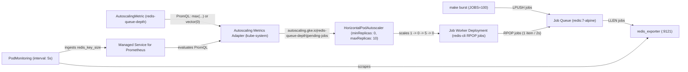

# Scaling Kubernetes deployments to zero on GKE 1.37 without KEDA

Queue workers spend a lot of time doing nothing. If you run batch document parsers, webhook consumers, or background job processors, keeping `minReplicas: 1` alive across dozens of services burns cluster capacity all night just waiting for a message to arrive.

Until now, scaling a Deployment down to zero pods on Google Kubernetes Engine meant picking between two compromises.

You could install KEDA. I like KEDA, and for complex event sources it is still great, but it means running another operator and another metrics API server in `kube-system`, plus teaching every team `ScaledObject` CRDs instead of standard `HorizontalPodAutoscaler` manifests.

Or you could wire up `custom-metrics-stackdriver-adapter` with Workload Identity and scale against a Cloud Monitoring metric like Cloud Pub/Sub `num_undelivered_messages`. That works on paper, but Pub/Sub metrics sample every 60 seconds and have up to a 150-second ingestion lag. Waiting two minutes for your first worker pod to wake up feels broken when a user is waiting on a job.

GKE 1.37 changes this math. Two native features now work together out of the box:

- Kubernetes `HPAScaleToZero` is enabled on the GKE control plane, so a standard `autoscaling/v2` HPA can set `minReplicas: 0` whenever it scales on `External` or `Object` metrics.
- GKE's `AutoscalingMetric` custom resource and managed `autoscaling-metrics-adapter` evaluate arbitrary PromQL queries against Google Cloud Managed Service for Prometheus and feed the result straight into the Kubernetes External Metrics API.

I built a small, zero-build repo at [github.com/moficodes/gke-hpa-scale-to-zero](https://github.com/moficodes/gke-hpa-scale-to-zero) to test how fast native GKE scale-to-zero actually reacts on a live `v1.37.0-gke.3503000` cluster. The workload wakes from `0` to `5` running pods in 11 seconds when 100 jobs hit the queue, drains the backlog, and scales cleanly back to `0`.

Getting there took three tries. Redis, Prometheus, and GKE's HPA controller each have a sharp edge when a workload hits zero replicas, and none of them are obvious until you watch an HPA get stuck on a live cluster.

Below is the full setup so you can run it yourself, followed by the three failure modes I hit and the live cluster trace.

## How the native GKE 1.37 path compares

| Feature | Legacy Stackdriver adapter | KEDA `ScaledObject` | GKE 1.37 `AutoscalingMetric` + `minReplicas: 0` |
| :--- | :--- | :--- | :--- |
| Metrics server in `kube-system` | Self-managed Deployment | Self-managed KEDA operator + adapter | GKE-managed `autoscaling-metrics-adapter` |
| HPA resource | Standard `autoscaling/v2` HPA | Generated and owned by KEDA | Standard `autoscaling/v2` HPA with `minReplicas: 0` |
| Query language | Cloud Monitoring filter strings | Scaler-specific YAML triggers | PromQL via `AutoscalingMetric` |
| Idle footprint when unused | Adapter pod always running | Operator and adapter pods always running | Adapter stays at `0/0` until an `AutoscalingMetric` with `promql` exists |
| Wake-from-zero reaction time | 60s to 90s+ on Pub/Sub metrics | 5s to 15s | 5s to 11s with a 5s `PodMonitoring` scrape |

One detail I appreciated right away is how GKE manages `kube-system/autoscaling-metrics-adapter`. On a fresh GKE 1.37 cluster, that Deployment sits at `0/0` replicas. You pay nothing for it. The moment you apply an `AutoscalingMetric` resource containing a `promql` block, GKE scales the adapter to `1/1` Ready automatically.

## What we are building

I wanted a demo anyone could run in two minutes without building container images, creating Cloud Pub/Sub topics, or configuring IAM service accounts. Everything runs inside the `hpa-scale-to-zero` namespace using two upstream images, `redis:7-alpine` and `oliver006/redis_exporter:v1.62.0`.



**Redis queue and exporter.** A single Redis pod stores pending work items in a list named `jobs`. A `redis_exporter` sidecar runs in the same pod with `--check-keys=jobs` and exposes the list length `LLEN jobs` on port `9121` as the Prometheus gauge `redis_key_size{key="jobs"}`.

**5-second `PodMonitoring`.** Google Cloud Managed Service for Prometheus scrapes the exporter port every `5s`.

**`AutoscalingMetric`.** A `redis-queue-depth` custom resource runs a PromQL query against Managed Service for Prometheus and exposes the result to HPA as an external metric named `autoscaling.gke.io|redis-queue-depth|pending-jobs`.

**HPA and worker Deployment.** `job-worker-hpa` targets an `AverageValue` of `20` pending jobs per pod, with `minReplicas: 0` and `maxReplicas: 10`. Each `job-worker` pod runs a tiny shell loop that pops one item from Redis every 2 seconds with `redis-cli -h redis-queue rpop jobs` and logs it to stdout.

## Follow along on your own cluster

If you have a GKE 1.37+ cluster with Managed Service for Prometheus enabled, you can run the whole loop in three commands. If you just want to see what happens, skip ahead to the three production lessons and the captured terminal output.

Clone the repository first:

```bash
git clone https://github.com/moficodes/gke-hpa-scale-to-zero.git
cd gke-hpa-scale-to-zero
```

### Step 1: Apply the manifests

First, look at `manifests/01-redis-queue.yaml`, which sets up the Redis instance, the exporter sidecar, and the 5-second `PodMonitoring` scrape:

```yaml
apiVersion: apps/v1
kind: Deployment
metadata:
  name: redis-queue
  namespace: hpa-scale-to-zero
spec:
  replicas: 1
  selector:
    matchLabels:
      app: redis-queue
  template:
    metadata:
      labels:
        app: redis-queue
    spec:
      containers:
        - name: redis
          image: redis:7-alpine
          ports:
            - name: redis
              containerPort: 6379
        - name: exporter
          image: oliver006/redis_exporter:v1.62.0
          args:
            - "--redis.addr=redis://localhost:6379"
            - "--check-keys=jobs"
          ports:
            - name: metrics
              containerPort: 9121
---
apiVersion: monitoring.googleapis.com/v1
kind: PodMonitoring
metadata:
  name: redis-queue-monitoring
  namespace: hpa-scale-to-zero
spec:
  selector:
    matchLabels:
      app: redis-queue
  endpoints:
    - port: metrics
      interval: 5s
```

Next is `manifests/02-worker-and-hpa.yaml`, which defines the `AutoscalingMetric`, the worker Deployment, and the HPA with `minReplicas: 0`:

```yaml
apiVersion: autoscaling.gke.io/v1beta1
kind: AutoscalingMetric
metadata:
  name: redis-queue-depth
  namespace: hpa-scale-to-zero
spec:
  metrics:
    - promql:
        name: pending-jobs
        type: External
        query: 'max(redis_key_size{namespace="hpa-scale-to-zero", key="jobs"}) or vector(0)'
---
apiVersion: apps/v1
kind: Deployment
metadata:
  name: job-worker
  namespace: hpa-scale-to-zero
spec:
  replicas: 1
  selector:
    matchLabels:
      app: job-worker
  template:
    metadata:
      labels:
        app: job-worker
    spec:
      terminationGracePeriodSeconds: 5
      containers:
        - name: worker
          image: redis:7-alpine
          command: ["/bin/sh", "-c"]
          args:
            - |
              echo "[$(date -u +'%Y-%m-%dT%H:%M:%SZ')] [$(hostname)] Job Worker started; polling redis-queue..."
              while true; do
                JOB="$(redis-cli -h redis-queue rpop jobs 2>/dev/null || true)"
                if [ -n "${JOB}" ]; then
                  echo "[$(date -u +'%Y-%m-%dT%H:%M:%SZ')] [$(hostname)] Processed job: ${JOB}"
                fi
                sleep 2
              done
---
apiVersion: autoscaling/v2
kind: HorizontalPodAutoscaler
metadata:
  name: job-worker-hpa
  namespace: hpa-scale-to-zero
spec:
  scaleTargetRef:
    apiVersion: apps/v1
    kind: Deployment
    name: job-worker
  minReplicas: 0
  maxReplicas: 10
  behavior:
    scaleUp:
      stabilizationWindowSeconds: 0
      policies:
        - type: Pods
          value: 10
          periodSeconds: 15
    scaleDown:
      stabilizationWindowSeconds: 15
  metrics:
    - type: External
      external:
        metric:
          name: autoscaling.gke.io|redis-queue-depth|pending-jobs
        target:
          type: AverageValue
          averageValue: "20"
```

Deploy both files with `make apply`:

```bash
make apply
```

### Step 2: Open the live observer

In one terminal pane, run `make watch` to refresh the queue depth, adapter status, HPA conditions, and worker pods every 2 seconds, or run `make status` for a single snapshot:

```bash
make watch
```

Within about 45 seconds of `make apply`, the initial worker pod scales down to `0/0` Ready and HPA reports `ScaledToZero=True`.

### Step 3: Push a 100-job burst

In a second terminal, push 100 synthetic jobs into Redis in one `LPUSH` call:

```bash
make burst JOBS=100
```

Watch the first terminal as HPA wakes `job-worker` from `0` to `5` pods, drains all 100 items, waits 15 seconds for the scale-down stabilization window, and scales back to `0`. When you are done, delete the namespace with `make clean`:

```bash
make clean
```

## Three things that bit me on a live cluster

Looking at `manifests/02-worker-and-hpa.yaml` above, you might wonder why the PromQL query ends with `or vector(0)`, why a scale-to-zero Deployment starts at `replicas: 1`, and why `scaleUp.policies` is explicitly set. Every one of those lines is there because my first attempt broke.

### 1. Redis deletes empty lists, which turns your PromQL metric into `<unknown>`

When you push 100 items into a Redis list with `LPUSH jobs ...`, `redis_exporter --check-keys=jobs` exports the gauge you expect:

```bash
redis_key_size{db="db0", key="jobs"} 100
```

The trap springs when a worker pops the last item from the list. In Redis, a list with zero elements does not exist. Redis deletes the `jobs` key immediately when `LLEN jobs` hits zero.

On the next 5-second scrape, `redis_exporter` stops emitting `redis_key_size{key="jobs"}` altogether. If your `AutoscalingMetric` query is just:

```yaml
query: 'max(redis_key_size{namespace="hpa-scale-to-zero", key="jobs"})'
```

then as soon as the queue drains and the Prometheus lookback window passes, that query returns an empty vector with zero time series.

`autoscaling-metrics-adapter` treats an empty PromQL result as a failed metric lookup. HPA records `MetricGetExternal` failure, displays `<unknown>/20 (avg)` in `kubectl get hpa`, flips `ScalingActive` to `False`, and refuses to scale down. Your workers stay stuck running forever against an empty queue because the metric disappeared at the exact moment you needed it to read `0`.

Appending `or vector(0)` in `AutoscalingMetric` fixes it:

```yaml
query: 'max(redis_key_size{namespace="hpa-scale-to-zero", key="jobs"}) or vector(0)'
```

Whenever `redis_key_size{key="jobs"}` exists, `max(...)` returns the queue depth. The instant Redis deletes the empty key, the union falls back to `vector(0)` so HPA gets a clean `0` sample and scales the Deployment down to zero. This same pattern applies to any Prometheus metric whose label set disappears when idle.

### 2. Starting a Deployment at `replicas: 0` disables HPA scaling

My first instinct for a scale-to-zero worker was to set `replicas: 0` in the `Deployment` YAML. When I applied the manifests before the metrics adapter finished warming up, HPA refused to scale the Deployment even after I pushed 100 jobs into Redis. `kubectl describe hpa` showed why:

```bash
Conditions:
  Type            Status  Reason                             Message
  ----            ------  ------                             -------
  AbleToScale     True    SucceededGetScale                  the HPA controller was able to get the target's current scale
  ScalingActive   False   ScalingDisabledReplicaCountZero    scaling is disabled since the replica count of the target is zero
```

If you manually run `kubectl scale deployment/job-worker --replicas=0` on a running workload, GKE sets a related reason, `ScalingDisabledExternalScaleToZero`.

Once you think about incident response, GKE's behavior makes sense. If an on-call engineer runs `kubectl scale --replicas=0` during an outage to stop a runaway consumer from hammering a downstream database, they do not want HPA to see the growing queue 15 seconds later and spin the pods right back up. GKE's HPA controller tracks who scaled the target to zero. If HPA itself scaled the workload down to zero, it sets `ScaledToZero: True` and keeps `ScalingActive: True`. If a human or a manifest set `spec.replicas = 0` outside HPA, the controller assumes an operator turned the service off on purpose and pauses autoscaling.

Starting `Deployment/job-worker` at `replicas: 1` avoids this completely. When `make apply` runs, one worker pod boots while `autoscaling-metrics-adapter` wakes up in `kube-system`. Once the adapter serves `0` from `or vector(0)`, HPA itself actuates the `1 -> 0` transition, setting `ScaledToZero=True` while keeping `ScalingActive=True`.

### 3. Default Kubernetes `scaleUp` policies cap wake-from-zero at 4 pods

When you omit `spec.behavior.scaleUp.policies` on an `autoscaling/v2` HPA, Kubernetes applies two default rules every 15 seconds and picks whichever allows the bigger jump:

```yaml
policies:
  - type: Pods
    value: 4
    periodSeconds: 15
  - type: Percent
    value: 100
    periodSeconds: 15
selectPolicy: Max
```

When a Deployment has 4 pods running, `100%` lets it double to 8 pods in a single step. When a Deployment is scaled to zero, `100%` of `0` is `0`.

That means on the wake-from-zero tick, every percentage policy evaluates to zero and only the `type: Pods` policy does anything. With the default `value: 4`, pushing 100 jobs with a target of 20 jobs per pod means HPA wants 5 pods, yet it only scales the Deployment from `0 -> 4` on the first tick and waits another 15 seconds to step from `4 -> 5`.

Adding an explicit `Pods` policy matching `maxReplicas: 10` lets HPA jump straight from `0` to `5` pods in one step:

```yaml
  behavior:
    scaleUp:
      stabilizationWindowSeconds: 0
      policies:
        - type: Pods
          value: 10
          periodSeconds: 15
```

## What the live `1 -> 0 -> 5 -> 0` loop looks like on GKE 1.37

Here is the real output from running `make verify` against my `v1.37.0-gke.3503000` cluster, `gke_mofilabs_us-central1-a_ate-cluster`.

### Stage 1: Initial `1 -> 0` scale-down after `make apply`

After `make apply`, `job-worker` starts at 1 replica while `autoscaling-metrics-adapter` rolls out in `kube-system`. Once the adapter starts serving `0` for `autoscaling.gke.io|redis-queue-depth|pending-jobs`, HPA scales `job-worker` from `1` down to `0`:

```bash
[2026-10-16T21:32:10Z] === Stage 1/5: Deploying stack via 'make apply' and verifying initial Zero-Scale State (1 -> 0) ===
kubectl --context=gke_mofilabs_us-central1-a_ate-cluster apply -f manifests/01-redis-queue.yaml
kubectl --context=gke_mofilabs_us-central1-a_ate-cluster apply -f manifests/02-worker-and-hpa.yaml
[2026-10-16T21:32:21Z]   [init-poll] spec.replicas=1 pods=1 | AbleToScale=True ScalingActive=True ScaledToZero=True
[2026-10-16T21:32:52Z]   [init-poll] spec.replicas=1 pods=1 | AbleToScale=True ScalingActive=True ScaledToZero=True
[2026-10-16T21:32:59Z]   [init-poll] spec.replicas=0 pods=0 | AbleToScale=True ScalingActive=True ScaledToZero=True
```

At `21:32:59Z`, `make status` shows the workload sitting at zero pods with all three HPA conditions healthy:

```bash
================================================================================
GKE HPA Scale-to-Zero Observer | 2026-10-16T21:32:59Z | context: gke_mofilabs_us-central1-a_ate-cluster
================================================================================
Job Queue (redis-queue)        : Queue Depth (LLEN jobs) = 0
AMA (kube-system)              : autoscaling-metrics-adapter = 1/1 Ready
AutoscalingMetric              : redis-queue-depth -> hpaName=autoscaling.gke.io|redis-queue-depth|pending-jobs (errors=none)
HPA (job-worker-hpa)           : desired=0 (min=0, max=10) | metric: avg=0 (value=0) / target=20 (avg)
HPA Conditions                 : AbleToScale=True | ScalingActive=True (ValidMetricFound) | ScaledToZero=True (ScaledToZero)
Job Worker (Deployment)        : job-worker = 0/0 Ready
--------------------------------------------------------------------------------
Job Worker Pods (namespace: hpa-scale-to-zero):
  (0 pods running - Zero-Scale State)
================================================================================
```

### Stage 2: Waking from `0` to `5` pods in 11 seconds

At `21:33:13Z`, `make burst JOBS=100` pushes 100 items into the Redis list:

```bash
[2026-10-16T21:33:13Z] === Stage 3/5: Triggering 100-job burst via 'make burst JOBS=100' and verifying 0 -> 5 scale-from-zero ===
Pushing 100 synthetic jobs into Redis Job Queue (namespace: hpa-scale-to-zero)...
Job Burst complete: pushed 100 items -> updated Queue Depth (LLEN jobs) = 100
[2026-10-16T21:33:15Z] Redis LLEN jobs immediately after burst: 100
[2026-10-16T21:33:18Z]   [scale-up poll +5s] LLEN=100 | HPA desired=5 ScaledToZero=False | deploy spec=0 ready=0
[2026-10-16T21:33:24Z]   [scale-up poll +11s] LLEN=90 | HPA desired=5 ScaledToZero=False | deploy spec=5 ready=5
[2026-10-16T21:33:24Z]   --> HPA actuated scale-from-zero (0 -> 5) at +11s (ScaledToZero=False)
[2026-10-16T21:33:24Z]   --> Reached target scale of 5/5 Ready job-worker replicas at +11s!
```

Five seconds after the burst, at `21:33:18Z`, `PodMonitoring` has scraped `redis_exporter`, Managed Service for Prometheus has ingested `redis_key_size = 100`, the adapter has served the new value, and HPA has set `desired=5` and `ScaledToZero=False`.

Six seconds after that, 11 seconds into the run at `21:33:24Z`, all five `job-worker` pods are `Running` and `Ready` and have already popped the first 10 jobs from Redis. Here is the `make status` snapshot with all 5 pods active:

```bash
================================================================================
GKE HPA Scale-to-Zero Observer | 2026-10-16T21:33:38Z | context: gke_mofilabs_us-central1-a_ate-cluster
================================================================================
Job Queue (redis-queue)        : Queue Depth (LLEN jobs) = 80
AMA (kube-system)              : autoscaling-metrics-adapter = 1/1 Ready
AutoscalingMetric              : redis-queue-depth -> hpaName=autoscaling.gke.io|redis-queue-depth|pending-jobs (errors=none)
HPA (job-worker-hpa)           : desired=5 (min=0, max=10) | metric: avg=13 (value=65) / target=20 (avg)
HPA Conditions                 : AbleToScale=True | ScalingActive=True (ValidMetricFound) | ScaledToZero=False (NotScaledToZero)
Job Worker (Deployment)        : job-worker = 5/5 Ready
--------------------------------------------------------------------------------
Job Worker Pods (namespace: hpa-scale-to-zero):
  NAME                          READY   STATUS    RESTARTS   AGE
  job-worker-755bf6d97d-6zvgf   1/1     Running   0          20s
  job-worker-755bf6d97d-8dvdz   1/1     Running   0          20s
  job-worker-755bf6d97d-cxqvw   1/1     Running   0          20s
  job-worker-755bf6d97d-fbxhq   1/1     Running   0          20s
  job-worker-755bf6d97d-fmf7p   1/1     Running   0          20s
Latest Worker Log              : [pod/job-worker-755bf6d97d-fmf7p/worker] [2026-10-16T21:33:38Z] [job-worker-755bf6d97d-fmf7p] Processed job: job-051@2026-10-16T21:33:14Z
================================================================================
```

And `make logs` shows all five pods pulling items off the Redis list in parallel:

```bash
[pod/job-worker-755bf6d97d-6zvgf/worker] [2026-10-16T21:33:18Z] [job-worker-755bf6d97d-6zvgf] Job Worker started; polling redis-queue...
[pod/job-worker-755bf6d97d-6zvgf/worker] [2026-10-16T21:33:18Z] [job-worker-755bf6d97d-6zvgf] Processed job: job-004@2026-10-16T21:33:14Z
[pod/job-worker-755bf6d97d-8dvdz/worker] [2026-10-16T21:33:18Z] [job-worker-755bf6d97d-8dvdz] Processed job: job-005@2026-10-16T21:33:14Z
[pod/job-worker-755bf6d97d-cxqvw/worker] [2026-10-16T21:33:18Z] [job-worker-755bf6d97d-cxqvw] Processed job: job-003@2026-10-16T21:33:14Z
[pod/job-worker-755bf6d97d-fbxhq/worker] [2026-10-16T21:33:18Z] [job-worker-755bf6d97d-fbxhq] Processed job: job-002@2026-10-16T21:33:14Z
[pod/job-worker-755bf6d97d-fmf7p/worker] [2026-10-16T21:33:18Z] [job-worker-755bf6d97d-fmf7p] Processed job: job-001@2026-10-16T21:33:14Z
```

### Stage 3: Draining the queue and scaling back to `0`

With five pods each popping one job every 2 seconds, the queue steps down from 80 to 40, 27, 19, 7, 2, and finally 0 at 55 seconds after the burst, at `21:34:08Z`:

```bash
[2026-10-16T21:33:42Z]   [drain poll +29s] LLEN=40 | deploy spec=4 ready=4
[2026-10-16T21:33:47Z]   [drain poll +34s] LLEN=27 | deploy spec=4 ready=4
[2026-10-16T21:33:53Z]   [drain poll +40s] LLEN=19 | deploy spec=4 ready=2
[2026-10-16T21:33:58Z]   [drain poll +45s] LLEN=7 | deploy spec=2 ready=2
[2026-10-16T21:34:03Z]   [drain poll +50s] LLEN=2 | deploy spec=2 ready=2
[2026-10-16T21:34:08Z]   [drain poll +55s] LLEN=0 | deploy spec=1 ready=1
[2026-10-16T21:34:08Z]   --> Job Queue drained to 0 at +55s since burst (28s drain duration)
```

Notice that HPA already trimmed the Deployment from 5 pods down to 4, then 2, and then 1 as the backlog shrank. Once `LLEN jobs` reaches `0`, Redis deletes the `jobs` key, `or vector(0)` keeps feeding `0` to HPA, and HPA waits for the 15-second `scaleDown.stabilizationWindowSeconds` window before terminating the last pod:

```bash
[2026-10-16T21:34:13Z]   [scale-down poll +5s after drain / +60s total] LLEN=0 | spec.replicas=1 pods=2 | AbleToScale=True ScalingActive=True ScaledToZero=False
[2026-10-16T21:34:20Z]   [scale-down poll +12s after drain / +67s total] LLEN=0 | spec.replicas=1 pods=1 | AbleToScale=True ScalingActive=True ScaledToZero=False
[2026-10-16T21:34:28Z]   [scale-down poll +20s after drain / +75s total] LLEN=0 | spec.replicas=0 pods=1 | AbleToScale=True ScalingActive=True ScaledToZero=True
[2026-10-16T21:34:35Z]   [scale-down poll +27s after drain / +82s total] LLEN=0 | spec.replicas=0 pods=0 | AbleToScale=True ScalingActive=True ScaledToZero=True
[2026-10-16T21:34:35Z]   --> Returned to Zero-Scale State (5 -> 0) at +27s after queue drain (+82s total since burst)!
```

Twenty seconds after the queue hits zero, 75 seconds after the burst, HPA sets `spec.replicas=0` and flips `ScaledToZero=True`. Seven seconds later, at 82 seconds total, the last pod finishes terminating:

```bash
================================================================================
GKE HPA Scale-to-Zero Observer | 2026-10-16T21:34:35Z | context: gke_mofilabs_us-central1-a_ate-cluster
================================================================================
Job Queue (redis-queue)        : Queue Depth (LLEN jobs) = 0
AMA (kube-system)              : autoscaling-metrics-adapter = 1/1 Ready
AutoscalingMetric              : redis-queue-depth -> hpaName=autoscaling.gke.io|redis-queue-depth|pending-jobs (errors=none)
HPA (job-worker-hpa)           : desired=0 (min=0, max=10) | metric: avg=0 (value=0) / target=20 (avg)
HPA Conditions                 : AbleToScale=True | ScalingActive=True (ValidMetricFound) | ScaledToZero=True (ScaledToZero)
Job Worker (Deployment)        : job-worker = 0/0 Ready
--------------------------------------------------------------------------------
Job Worker Pods (namespace: hpa-scale-to-zero):
  (0 pods running - Zero-Scale State)
================================================================================
```

### Timing breakdown on GKE `v1.37.0-gke.3503000`

| Event | Timestamp (UTC) | Elapsed from burst | HPA `desired` | `ScaledToZero` | `job-worker` Ready |
| :--- | :--- | :--- | :--- | :--- | :--- |
| Initial scale-to-zero complete (`1 -> 0`) | `21:32:59Z` | `-14s` | `0` | `True` | `0/0` |
| `make burst JOBS=100` (`LLEN jobs = 100`) | `21:33:13Z` | `0s` | `0` | `True` | `0/0` |
| HPA updates target scale (`0 -> 5`) | `21:33:18Z` | `+5s` | `5` | `False` | `0/0` |
| All 5 `job-worker` pods `Running` & `Ready` | `21:33:24Z` | `+11s` | `5` | `False` | `5/5` |
| Queue drained (`LLEN jobs = 0`) | `21:34:08Z` | `+55s` | `1` | `False` | `1/1` |
| HPA scales to zero after 15s window | `21:34:28Z` | `+75s` | `0` | `True` | `0/1` |
| Final pod terminated (`0/0` Ready) | `21:34:35Z` | `+82s` | `0` | `True` | `0/0` |

All the manifests, the observer script, and the end-to-end verification script live in [github.com/moficodes/gke-hpa-scale-to-zero](https://github.com/moficodes/gke-hpa-scale-to-zero).
