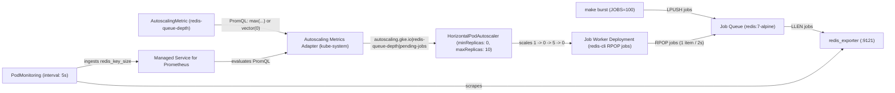

# GKE 1.37 HPA Scale-to-Zero (`minReplicas: 0`) Demo

Self-contained, zero-build reference for native Kubernetes Horizontal Pod Autoscaler (HPA) scale-to-zero (`minReplicas: 0`) on GKE 1.37+ (`v1.37.0-gke.3503000`). The stack runs in the `hpa-scale-to-zero` namespace and pairs an in-cluster Redis Job Queue (`redis:7-alpine` + `oliver006/redis_exporter:v1.62.0`) with Google Cloud Managed Service for Prometheus (`PodMonitoring`), GKE's `AutoscalingMetric` custom resource (`autoscaling.gke.io/v1beta1`), and the managed Autoscaling Metrics Adapter (AMA).

For the full architectural walkthrough, PromQL design, and live GKE 1.37 trace analysis, read [BLOG.md](BLOG.md).

## Architecture



## Prerequisites

1. A GKE cluster running version `1.37` or later (verified on `v1.37.0-gke.3503000`) where Kubernetes `HPAScaleToZero` is enabled on the control plane and GKE's managed Autoscaling Metrics Adapter (AMA) is installed in `kube-system`.
2. Google Cloud Managed Service for Prometheus enabled on the cluster (`monitoring.googleapis.com/v1` `PodMonitoring` CRD present).
3. `kubectl` and `make` configured locally. Every `Makefile` target accepts `KUBE_CONTEXT=<your-context>` (defaults to your current `kubectl` context).

No custom container builds, Dockerfiles, Cloud Pub/Sub subscriptions, or GCP IAM / Workload Identity bindings are required.

## Quickstart in three commands

### 1. Deploy the stack

```bash
make apply
```

This creates the `hpa-scale-to-zero` namespace, deploys the Redis Job Queue and `5s` `PodMonitoring` scraper (`manifests/01-redis-queue.yaml`), and applies the `AutoscalingMetric`, Job Worker Deployment (`replicas: 1`), and HPA (`manifests/02-worker-and-hpa.yaml`). Within about 45 seconds, AMA wakes from `0` to `1` replica in `kube-system` and HPA scales the Job Worker from `1` down to `0` replicas (Zero-Scale State).

### 2. Watch the scaling loop in one terminal pane

```bash
make watch
```

`make watch` refreshes every 2 seconds and shows live Queue Depth (`LLEN jobs`), AMA readiness, `AutoscalingMetric` status, HPA targets and conditions (`AbleToScale`, `ScalingActive`, `ScaledToZero`), active Job Worker pods, and the latest processed job log line. For a single snapshot without clearing the screen, run `make status`.

```text
================================================================================
GKE HPA Scale-to-Zero Observer | 2026-10-16T21:32:59Z | context: gke_mofilabs_us-central1-a_ate-cluster
================================================================================
Job Queue (redis-queue)        : Queue Depth (LLEN jobs) = 0
AMA (kube-system)              : autoscaling-metrics-adapter = 1/1 Ready
AutoscalingMetric              : redis-queue-depth -> hpaName=autoscaling.gke.io|redis-queue-depth|pending-jobs (errors=none)
HPA (job-worker-hpa)           : desired=0 (min=0, max=10) | metric: avg=0 (value=0) / target=20 (avg)
HPA Conditions                 : AbleToScale=True | ScalingActive=True (ValidMetricFound) | ScaledToZero=True (ScaledToZero)
Job Worker (Deployment)        : job-worker = 0/0 Ready
--------------------------------------------------------------------------------
Job Worker Pods (namespace: hpa-scale-to-zero):
  (0 pods running — Zero-Scale State)
================================================================================
```

### 3. Trigger a 100-item Job Burst

In a second terminal (or after `make status`), push 100 synthetic work items into the Job Queue:

```bash
make burst JOBS=100
```

```text
Pushing 100 synthetic jobs into Redis Job Queue (namespace: hpa-scale-to-zero)...
Job Burst complete: pushed 100 items -> updated Queue Depth (LLEN jobs) = 100
```

Within 5 seconds of the burst, HPA observes the external metric `autoscaling.gke.io|redis-queue-depth|pending-jobs` jump to `100`, computes `100 / 20 = 5` desired replicas, sets `ScaledToZero=False`, and scales `Deployment/job-worker` from `0` to `5` running pods:

```text
================================================================================
GKE HPA Scale-to-Zero Observer | 2026-10-16T21:33:38Z | context: gke_mofilabs_us-central1-a_ate-cluster
================================================================================
Job Queue (redis-queue)        : Queue Depth (LLEN jobs) = 80
AMA (kube-system)              : autoscaling-metrics-adapter = 1/1 Ready
AutoscalingMetric              : redis-queue-depth -> hpaName=autoscaling.gke.io|redis-queue-depth|pending-jobs (errors=none)
HPA (job-worker-hpa)           : desired=5 (min=0, max=10) | metric: avg=13 (value=65) / target=20 (avg)
HPA Conditions                 : AbleToScale=True | ScalingActive=True (ValidMetricFound) | ScaledToZero=False (NotScaledToZero)
Job Worker (Deployment)        : job-worker = 5/5 Ready
--------------------------------------------------------------------------------
Job Worker Pods (namespace: hpa-scale-to-zero):
  NAME                          READY   STATUS    RESTARTS   AGE
  job-worker-755bf6d97d-6zvgf   1/1     Running   0          20s
  job-worker-755bf6d97d-8dvdz   1/1     Running   0          20s
  job-worker-755bf6d97d-cxqvw   1/1     Running   0          20s
  job-worker-755bf6d97d-fbxhq   1/1     Running   0          20s
  job-worker-755bf6d97d-fmf7p   1/1     Running   0          20s
Latest Worker Log              : [pod/job-worker-755bf6d97d-fmf7p/worker] [2026-10-16T21:33:38Z] [job-worker-755bf6d97d-fmf7p] Processed job: job-051@2026-10-16T21:33:14Z
================================================================================
```

Each Job Worker pod pops 1 item every 2 seconds. Once Queue Depth reaches `0` (~55 seconds after the burst) and remains at `0` for the 15-second Scale-Down Stabilization Window (`spec.behavior.scaleDown.stabilizationWindowSeconds: 15`), HPA scales the Deployment back to `0/0` Ready (`ScaledToZero=True`).

## Makefile targets

| Target | Command | What it does |
| :--- | :--- | :--- |
| `apply` | `make apply` | Deploys `manifests/01-redis-queue.yaml` and `manifests/02-worker-and-hpa.yaml` |
| `burst` | `make burst JOBS=100` | Pushes `JOBS` synthetic items into the Redis Job Queue in one `LPUSH` call |
| `watch` | `make watch INTERVAL=2` | Continuously renders the single-pane observer every `INTERVAL` seconds |
| `status` | `make status` | Prints a one-shot observer snapshot (`./hack/watch.sh --once`) |
| `logs` | `make logs` | Prints recent processed job log lines across running Job Worker pods |
| `verify` | `make verify` | Runs `./hack/verify-e2e.sh` to assert the full `1 -> 0 -> 5 -> 0` lifecycle |
| `clean` | `make clean` | Deletes all demo manifests and the `hpa-scale-to-zero` namespace |

## Production lessons and troubleshooting

### 1. HPA shows `<unknown>` when the Redis list is empty (`ADR-0001`)

When a Redis list empties (`LLEN jobs == 0`), Redis deletes the `jobs` key altogether. As a result, `redis_exporter` stops emitting the `redis_key_size{key="jobs"}` time series. If the `AutoscalingMetric` PromQL query is just `max(redis_key_size{namespace="hpa-scale-to-zero", key="jobs"})`, Prometheus returns an empty vector, which AMA reports as a missing metric (`<unknown>` in HPA) and blocks scale-down to zero.

Fix: Append `or vector(0)` in `AutoscalingMetric` ([docs/adr/0001-redis-podmonitoring-over-pubsub-for-fast-scale-to-zero.md](docs/adr/0001-redis-podmonitoring-over-pubsub-for-fast-scale-to-zero.md)):

```yaml
query: 'max(redis_key_size{namespace="hpa-scale-to-zero", key="jobs"}) or vector(0)'
```

### 2. HPA pauses with `ScalingDisabledReplicaCountZero` (`ADR-0002`)

If you create a Deployment with `replicas: 0` before AMA has published initial metric samples, or if you manually run `kubectl scale deployment/job-worker --replicas=0`, GKE's HPA controller enters an External Scale-to-Zero Override state (`ScalingActive: False` with reason `ScalingDisabledReplicaCountZero` or `ScalingDisabledExternalScaleToZero`). This safeguard assumes a human operator intentionally turned the workload off and refuses to scale it back up automatically.

Fix: Declare `replicas: 1` in `Deployment/job-worker` ([docs/adr/0002-initial-single-replica-for-hpa-actuated-scale-to-zero.md](docs/adr/0002-initial-single-replica-for-hpa-actuated-scale-to-zero.md)) so HPA itself actuates the `1 -> 0` transition (`ScaledToZero: True`, `ScalingActive: True`). If a Deployment is already stuck in `ScalingDisabledReplicaCountZero`, run `kubectl scale deployment/job-worker -n hpa-scale-to-zero --replicas=1` once to hand control back to HPA.

### 3. Wake-from-zero stops at 4 replicas on the first tick (`ADR-0003`)

Kubernetes HPA's default `scaleUp` policy allows the maximum of `100%` of current replicas or `4` pods per 15 seconds. When waking from `0` replicas, `100%` of `0` is `0`, so the default `Pods: 4` limit caps the initial wake-from-zero step at `4` replicas even when a 100-item Job Burst demands `5` or `10` pods.

Fix: Configure an explicit `Pods` policy in `spec.behavior.scaleUp.policies` ([docs/adr/0003-explicit-pods-scaleup-policy-for-wake-from-zero.md](docs/adr/0003-explicit-pods-scaleup-policy-for-wake-from-zero.md)):

```yaml
behavior:
  scaleUp:
    stabilizationWindowSeconds: 0
    policies:
      - type: Pods
        value: 10
        periodSeconds: 15
```

## Repository layout

- `manifests/01-redis-queue.yaml`: `Namespace/hpa-scale-to-zero`, `Deployment/redis-queue` (`redis:7-alpine` + `oliver006/redis_exporter:v1.62.0`), `Service/redis-queue`, and `PodMonitoring/redis-queue-monitoring` (`interval: 5s`).
- `manifests/02-worker-and-hpa.yaml`: `AutoscalingMetric/redis-queue-depth`, `Deployment/job-worker`, and `HorizontalPodAutoscaler/job-worker-hpa` (`minReplicas: 0`).
- `Makefile`: Operator entry points (`apply`, `burst`, `watch`, `status`, `logs`, `verify`, `clean`).
- `hack/watch.sh`: Single-pane terminal observer supporting both live refresh and `--once` snapshots.
- `hack/verify-e2e.sh`: Automated end-to-end verification harness for the `1 -> 0 -> 5 -> 0` lifecycle.
- `GLOSSARY.md` & `docs/adr/`: Domain vocabulary and architectural decision records (`ADR-0001`, `ADR-0002`, `ADR-0003`).
- `BLOG.md`: Deep-dive technical article with captured GKE 1.37 outputs and timing breakdown.
