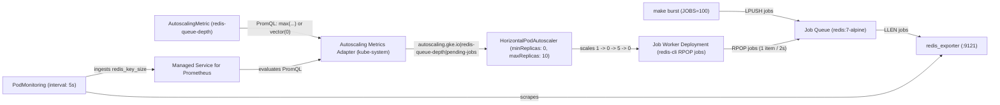

# GKE 1.37 HPA scale-to-zero (`minReplicas: 0`) demo

Zero-build reference for native Kubernetes Horizontal Pod Autoscaler scale-to-zero (`minReplicas: 0`) on GKE 1.37+. Everything runs inside the `hpa-scale-to-zero` namespace using an in-cluster Redis job queue (`redis:7-alpine` and `oliver006/redis_exporter:v1.62.0`), Google Cloud Managed Service for Prometheus (`PodMonitoring`), GKE's `AutoscalingMetric` custom resource (`autoscaling.gke.io/v1beta1`), and the managed `autoscaling-metrics-adapter`.

For the full walkthrough, read [BLOG.md](BLOG.md). For deep dives on the three PromQL and HPA edge cases, see [TROUBLESHOOTING.md](TROUBLESHOOTING.md).


## Architecture



## Prerequisites

1. A GKE cluster running version `1.37` or later, verified on `v1.37.0-gke.3503000`, where Kubernetes `HPAScaleToZero` is enabled and GKE's managed `autoscaling-metrics-adapter` is installed in `kube-system`.
2. Google Cloud Managed Service for Prometheus enabled on the cluster so the `monitoring.googleapis.com/v1` `PodMonitoring` CRD is present.
3. `kubectl` and `make` configured locally. Every `Makefile` target accepts `KUBE_CONTEXT=<your-context>` and defaults to your current `kubectl` context.

No custom container builds, Dockerfiles, Cloud Pub/Sub subscriptions, or GCP IAM bindings are required.

## Run it in three commands

### 1. Deploy the stack

```bash
make apply
```

This creates the `hpa-scale-to-zero` namespace, deploys the Redis queue and `5s` `PodMonitoring` scraper from `manifests/01-redis-queue.yaml`, and applies the `AutoscalingMetric`, worker Deployment, and HPA from `manifests/02-worker-and-hpa.yaml`. Within about 45 seconds, `kube-system/autoscaling-metrics-adapter` wakes from `0` to `1` replica and HPA scales `job-worker` from `1` down to `0` replicas.

### 2. Watch the scaling loop in one terminal pane

```bash
make watch
```

`make watch` refreshes every 2 seconds and prints the live queue depth `LLEN jobs`, adapter readiness, `AutoscalingMetric` status, HPA targets and conditions, active worker pods, and the latest processed job log line. For a single snapshot without clearing the screen, run `make status`.

### 3. Trigger a 100-item job burst

In a second terminal, push 100 synthetic work items into Redis:

```bash
make burst JOBS=100
```

Within 5 seconds of the burst, HPA sees `autoscaling.gke.io|redis-queue-depth|pending-jobs` jump to `100`, computes `100 / 20 = 5` desired replicas, sets `ScaledToZero=False`, and scales `Deployment/job-worker` from `0` to `5` running pods. Each worker pod pops 1 item every 2 seconds. Once the queue drains to `0` around 55 seconds after the burst and stays at `0` for the 15-second `scaleDown.stabilizationWindowSeconds` window, HPA scales the Deployment back to `0/0` Ready.

When finished, delete all resources with `make clean`:

```bash
make clean
```

## Makefile targets

| Target | Command | What it does |
| :--- | :--- | :--- |
| `apply` | `make apply` | Deploys `manifests/01-redis-queue.yaml` and `manifests/02-worker-and-hpa.yaml` |
| `burst` | `make burst JOBS=100` | Pushes `JOBS` synthetic items into the Redis queue in one `LPUSH` call |
| `watch` | `make watch INTERVAL=2` | Refreshes the single-pane observer every `INTERVAL` seconds |
| `status` | `make status` | Prints a one-shot observer snapshot via `./hack/watch.sh --once` |
| `logs` | `make logs` | Prints recent processed job log lines across running worker pods |
| `verify` | `make verify` | Runs `./hack/verify-e2e.sh` to assert the full `1 -> 0 -> 5 -> 0` cycle |
| `clean` | `make clean` | Deletes all demo manifests and the `hpa-scale-to-zero` namespace |

## Things to keep in mind

- **Use `or vector(0)` when your idle metric disappears.** Redis deletes a list key when the last item is popped, which stops `redis_exporter` from emitting `redis_key_size{key="jobs"}`. Appending `or vector(0)` prevents `<unknown>` metrics in HPA. See [TROUBLESHOOTING.md #1](TROUBLESHOOTING.md#1-empty-redis-lists-and-or-vector0-in-autoscalingmetric) and [ADR-0001](docs/adr/0001-redis-podmonitoring-over-pubsub-for-fast-scale-to-zero.md).
- **Start the Deployment at `replicas: 1`, not `replicas: 0`.** Deploying at `replicas: 0` before the adapter is ready triggers `ScalingDisabledReplicaCountZero`. Starting at `replicas: 1` lets HPA itself actuate the initial `1 -> 0` transition (`ScaledToZero: True`). See [TROUBLESHOOTING.md #2](TROUBLESHOOTING.md#2-starting-at-replicas-1-instead-of-replicas-0-scalingdisabledreplicacountzero) and [ADR-0002](docs/adr/0002-initial-single-replica-for-hpa-actuated-scale-to-zero.md).
- **Set an explicit `Pods` policy in `scaleUp.policies`.** Because `100%` of `0` replicas is `0`, Kubernetes HPA's default `Pods: 4` rule caps wake-from-zero at 4 pods unless `scaleUp.policies` raises the `Pods` limit. See [TROUBLESHOOTING.md #3](TROUBLESHOOTING.md#3-default-scaleup-policies-cap-wake-from-zero-at-4-pods) and [ADR-0003](docs/adr/0003-explicit-pods-scaleup-policy-for-wake-from-zero.md).

## Repository layout

**`manifests/01-redis-queue.yaml`.** Defines `Namespace/hpa-scale-to-zero`, `Deployment/redis-queue`, `Service/redis-queue`, and `PodMonitoring/redis-queue-monitoring`.

**`manifests/02-worker-and-hpa.yaml`.** Defines `AutoscalingMetric/redis-queue-depth`, `Deployment/job-worker`, and `HorizontalPodAutoscaler/job-worker-hpa` with `minReplicas: 0`.

**`Makefile`.** Provides `apply`, `burst`, `watch`, `status`, `logs`, `verify`, and `clean`.

**`hack/watch.sh`.** Renders the single-pane terminal observer in live or `--once` mode.

**`hack/verify-e2e.sh`.** Runs the automated end-to-end `1 -> 0 -> 5 -> 0` test against a live cluster.

**`TROUBLESHOOTING.md`, `GLOSSARY.md`, and `docs/adr/`.** Document the failure modes, domain terms, and architecture decision records `ADR-0001`, `ADR-0002`, and `ADR-0003`.

**`BLOG.md`.** Full blog post with the walkthrough and live demo.
